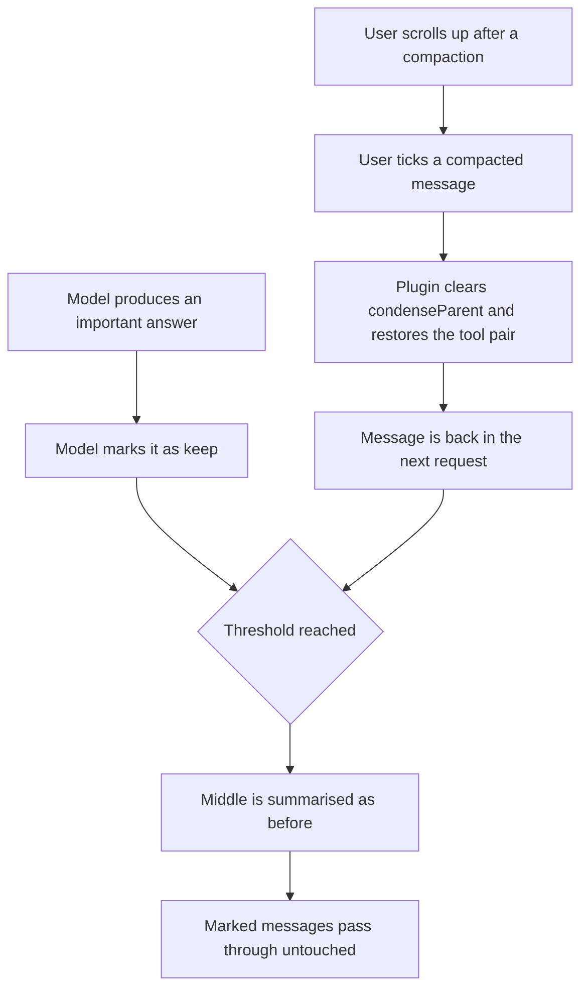

# Continuous context management: keeping a long task alive

Date: 2026-09-11

> Historical proposal, not current implementation instructions. The later [freeze design snapshot](2026-09-11-blocks-C-D-design.md) supersedes the early skip/ancestry-clearing mechanics below: frozen messages participate in summarization and are retained when effective context is assembled. Current task memory, compression recovery and delivery scope are described in [README](../README.md). Statuses below are historical.
> Status: **Block A approved for implementation. Block B deferred — it may turn out to be unnecessary.**

Cancelled and not to be revisited without a new request:

- routing work to a cheaper model (cancelled 2026-09-11);
- automatic collapsing of repeated file reads (cancelled 2026-09-11 — repeated reads are fine).

Goal: the model must be able to work on one task for a very long time without losing the task.

---

## 1. Why the task gets lost today

[`manageContext()`](../src/core/context-management/index.ts:260) stays silent until usage crosses a
threshold (default 90%). Then, in one shot, `summarizeConversation()` compresses everything except
the first message and the last `N_MESSAGES_TO_KEEP = 3`; the compressed region is tagged with
`condenseParent` and stops being sent; if that fails, `truncateConversation()` hides half of the
history.

Two structural problems:

- one summary must carry everything, produced at the worst possible moment;
- retention is by **recency**, not importance — the plan from message 2 and a requirement from
  message 40 are compressed like an `ls` output.

Block A attacks the second problem directly, and may well be enough on its own.

---

## 2. Block A — explicit keep marks (approved)

Compaction keeps working as it does. Everything in the middle is still summarised — **except
messages carrying a keep mark**, which survive unchanged.

### 2.1 Permissions

| Actor | May mark                                            | May unmark                                                    |
| ----- | --------------------------------------------------- | ------------------------------------------------------------- |
| Model | its own messages, the user's messages, tool results | any mark, including the user's, **when the user asks for it** |
| User  | any message, through a control in the chat          | any mark                                                      |

The maintainer's example: "снимай все и пиши заново задачу и ставь на неё галочку" — so the model
must be able to clear marks in bulk on request. To keep that from becoming silent data loss, the
unpin tool reports exactly which messages it cleared, and the user can re-pin from the chat.

### 2.2 Restoring an already compacted message — the key behaviour

The maintainer's scenario: the middle was compacted, he scrolls up, finds something valuable,
ticks it, **and it comes back into the model's context.** Yes, that is how it must work, and the
existing architecture supports it directly.

Condense is already non-destructive: a compacted message keeps living in
`api_conversation_history.json` with a `condenseParent` pointing at the summary, and
[`getEffectiveApiHistory()`](../src/core/condense/index.ts:1079) filters it out only because that
pointer exists. Pinning a compacted message therefore means: set `pinned`, clear `condenseParent`
(and `truncationParent`). The message immediately reappears in the next request.

Three details that must be handled, or this breaks the API:

1. **Tool pairing.** If the restored message contains a `tool_result`, its matching `tool_use` must
   be restored too, and vice versa. Restoration works on the whole pair, never on half of it. The
   logic in `getKeepMessagesWithToolBlocks()` already knows how to find the partner by id.
2. **Duplication with the summary.** The summary still mentions what the restored message said. That
   is acceptable — slight redundancy, no contradiction — but the restored message should be prefixed
   with a short marker such as `[restored by user]` so the model does not read it as new input.
3. **Budget.** Restoration adds tokens. It is checked against the same pinned budget (below) and
   refuses with a clear message rather than silently overflowing the window.

### 2.3 Filtering the chat to marked messages only

Requested explicitly: during a long session, scrolling up is unusable. A toggle at the top of the
chat switches the transcript to **marked messages only**; everything else is hidden until it is
switched off. Purely a view filter — it changes nothing in the history or in what is sent to the
model.

Placement candidates, to be decided during implementation: next to the existing task header
controls in `ChatView`, as a small toggle with a count (`Marked: 7`).

### 2.4 Data model

```ts
// ApiMessage additions
pinned?: boolean          // never hidden by condense or sliding window
pinnedBy?: "model" | "user"
pinnedNote?: string       // short reason, shown in the UI
pinnedAt?: number
pinRestored?: boolean     // was brought back after having been compacted
```

`ClineMessage` needs the same flag so the webview can render the state, and a new webview message
(`togglePinnedMessage { messageTs, pinned }`) handled in
[`webviewMessageHandler.ts`](../src/core/webview/webviewMessageHandler.ts:168) — `findMessageIndices`
already maps a chat timestamp to both histories, which is exactly what is needed.

### 2.5 Where the flag takes effect

- [`summarizeConversation()`](../src/core/condense/index.ts:975): the loop assigning `condenseParent`
  skips `msg.pinned`.
- [`truncateConversation()`](../src/core/context-management/index.ts:80): pinned messages are
  excluded from the truncation candidates, exactly as the first message already is.
- Pinned messages remain visible to the model that writes the summary.

### 2.6 Safety rails

- **Pinned budget: 50% of the context window by default, adjustable in settings.** Exceeding it makes
  the pin (or restore) refuse, naming the oldest marks; nothing is ever dropped silently.
- A cap on the number of marks per task.
- Marks survive task reload — they live in the persisted history, not in memory.

### 2.7 Flow



---

## 3. Block B — `CURRENT_TASK.md` as the permanent home of the task (deferred)

Recorded in full, but **not scheduled**: Block A may solve the problem entirely, in which case
Block B is unnecessary. It will be reconsidered only after Block A has been used in practice.

Block B is not a new feature — it is a modification of the **existing Intelligent Task mode**
(`src/core/task-document/`). Its settings checkbox stays, because the maintainer must be able to
turn the whole thing off.

The intended behaviour, for the record:

1. The moment the model accepts a task and understands the plan, it writes that plan into
   `CURRENT_TASK.md` — before substantive work.
2. With that same write it emits its first `update_todo_list`. The document holds the big task; the
   TODO holds the small steps of the current stage.
3. The document may be expansive: for each TODO item it can describe what that item contains and
   what has to be done inside it. The TODO stays a few lines; the document carries the detail.
4. Every completed step, every finished TODO, every material change is recorded incrementally — not
   rewritten wholesale, not deferred to compaction.
5. Any new request from the user becomes an entry in the document before work on it starts.
6. A single small task needs no TODO list; a TODO list is required as soon as there are two tasks or
   a new one arrives.
7. When compaction triggers and the document is fresh, the preparation LLM call could be skipped
   entirely — the plan is already on disk and is re-read into every request by
   [`TaskDocumentSession`](../src/core/task-document/session.ts:60).

---

## 4. Staging

| Stage | Contents                                                                                                               | Status   |
| ----- | ---------------------------------------------------------------------------------------------------------------------- | -------- |
| 1     | Block A: fields, condense/truncate exemption, pin/unpin tool, chat toggle, restore, marked-only filter, budget setting | approved |
| 2     | Block B modifications to the Intelligent Task mode                                                                     | deferred |

Stage 1 ships on its own with a version bump, a changeset, and verification in both VS Code and
PhpStorm.

---

## 5. Rejected

- `compact_context` rewriting blocks in place — replaced by keep marks.
- Automatic collapsing of repeated file reads.
- Line-range compaction inside a block.
